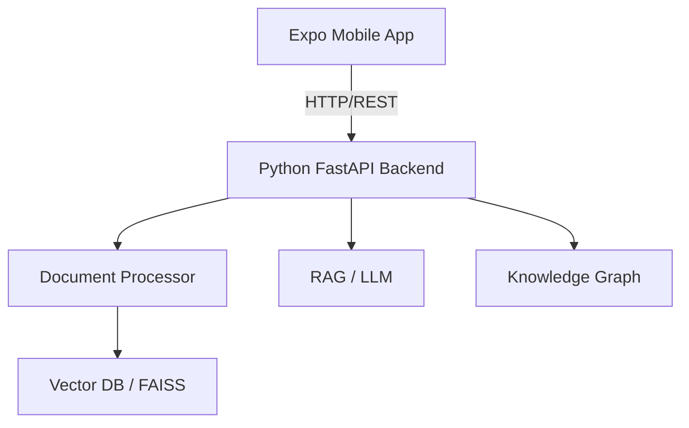

# FINAL_INTEGRATION_PLAN

## A. Existing architecture of each project
- **pdf/**: A Python-based AI document intelligence backend (FastAPI/Streamlit). It contains modules for document ingestion, embeddings, LLM, knowledge graph, and RAG.
- **prince-flutter/**: A Flutter-based camera/scanning prototype, featuring camera permissions, previews, captures, face/document detection features.
- **documind-ai/**: An Expo (React Native) application serving as the UI shell. It uses Expo Router, but is currently in a foundational state with various placeholder screens.

## B. Features already implemented
- **Backend (pdf/)**: PDF/DOCX processing, text extraction, chunking, embeddings, RAG, LLM integration, Knowledge Graph (Neo4j), FastAPI routes, Streamlit UI.
- **Flutter (prince-flutter/)**: Native camera workflows, capture, retake, image handling.
- **Expo (documind-ai/)**: Basic navigation shell, dummy screens for compare, knowledge graph, insights, documents, settings.

## C. Features partially implemented
- **documind-ai/**: Document ingestion UI, AI querying interface, comparison UI (mostly mockData).
- **Backend**: Hybrid search and specific advanced RAG workflows might need specific prompt tuning for the mobile client.

## D. Features missing
- A unified document ingestion API layer in React Native.
- Real integration between React Native and the Python backend.
- Translation of Flutter's camera logic to `expo-camera` or `expo-image-picker`.
- Complete error handling and offline state management in Expo.

## E. Duplicate functionality
- `mobile/` and `mobile_flutter/` folders inside `pdf/` seem to be old attempts at mobile integrations.
- Streamlit UI in `pdf/` serves a similar purpose to the new Expo app (but for web/admin).

## F. Conflicting implementations
- The `prince-flutter` project uses Dart/Flutter while the final architecture requires React Native. We cannot embed the Flutter app directly.

## G. Code that should be reused
- **Backend**: The entire `pdf/` repository structure (`document/`, `embedding/`, `knowledge_graph/`, `rag/`, `routes/`, `storage/`).
- **Frontend**: The styling and routing patterns established in `documind-ai`.

## H. Code that should remain untouched
- Unrelated Python backend logic.
- Core RAG and Knowledge Graph extraction logic in `pdf/`.

## I. Camera integration strategy
- Extract the logic flow from `prince-flutter` (Permissions -> Preview -> Capture -> Retake/Confirm).
- Implement this flow natively in `documind-ai` using `expo-camera` and `expo-image-picker`.

## J. Mobile/backend communication strategy
- Use RESTful communication over HTTP.
- Mobile client uses `EXPO_PUBLIC_API_URL` to point to the FastAPI backend.
- React Query (TanStack Query) should be used for data fetching, caching, and loading states.

## K. Recommended API architecture
- `POST /api/documents/upload`
- `GET /api/documents`
- `GET /api/documents/{id}`
- `POST /api/ask` (RAG queries)
- `POST /api/documents/compare`
- `GET /api/documents/{id}/insights`
- `GET /api/documents/{id}/knowledge-graph`

## L. Final PS23 feature architecture

## M. Phase-by-phase implementation plan
1. **Stabilize**: Fix existing `documind-ai` Expo configuration, TypeScript errors, and routing.
2. **Camera**: Re-implement `prince-flutter` camera logic in `documind-ai` using Expo tools.
3. **Ingestion Layer**: Create `DocumentInput` abstraction in React Native.
4. **Backend Integration**: Connect `documind-ai` to `pdf/` FastAPI routes.
5. **Intelligence Layer**: Implement summary, classification, and entities UI.
6. **RAG Integration**: Connect the Ask AI feature to the backend.
7. **Comparison & Graph**: Implement Document Compare and Entity Explorer.
8. **Insights & Reports**: Implement Insights and Report generation.
9. **UX Refinement & Firebase**: Final polish and authentication overlay.
10. **Validation**: End-to-end testing.
